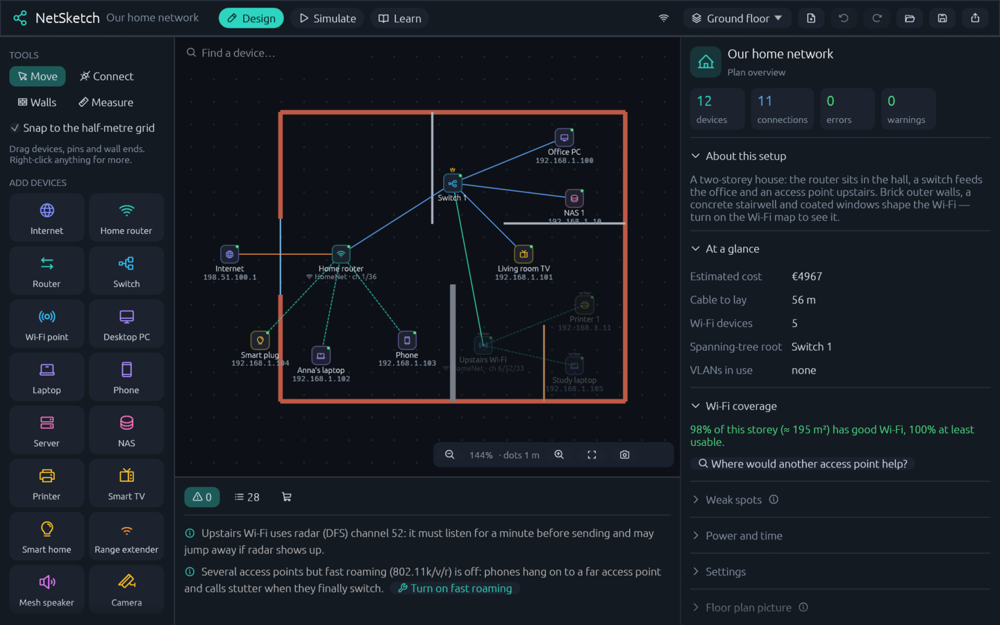

# NetSketch

**Plan, simulate and learn home networks.** Draw your home, place real routers, mesh nodes and access points, see where the Wi-Fi reaches and why a cable is slow, then send packets through it all. Every problem it finds comes with a plain-English explanation and, where it can, a one-click fix.

NetSketch started as a modern successor to [Filius](https://www.lernsoftware-filius.de/), the classic tool for teaching how networks work. It keeps the teaching side and adds what you need to plan a real home or small office.



## What it does

### Design your network
- Drag routers, switches, access points, extenders, mesh speakers, PCs, phones, TVs, NAS boxes, cameras and more onto the map, and connect them with Cat 5/5e/6/6A, fibre, powerline, Wi-Fi or a 5G backup line.
- Draw walls by material (drywall, brick, concrete, glass, metal…). Work across several storeys, and put a picture of your floor plan underneath to trace over.
- Model **ports properly**: a router can have "1 × 10G SFP+ WAN, 1 × 2.5G, 4 × 1G". Every cable plugs into a specific port, and its speed comes from the ports at both ends.
- Plan VLANs, guest Wi-Fi, firewall rules, IPv6, Power over Ethernet budgets and spanning tree.

### Pick real hardware instead of typing specs
A built-in catalog fills in the radio, ports, power draw and price in one click:

| | |
|---|---|
| **287 devices** from 25 brands | Home routers, gateways and firewalls, mesh systems, range extenders, ceiling access points, outdoor point-to-point bridges and plain wired routers |
| **Swiss providers** | All 21 Swisscom routers and WLAN-Boxes from Centro Grande to Internet-Box 5 Pro, plus 25 boxes from Sunrise, Salt and Quickline |
| **Popular brands** | AVM FRITZ!, TP-Link (Archer, Deco, Omada), Netgear (Nighthawk, Orbi), ASUS, Ubiquiti UniFi, eero, Google, Linksys, devolo, MikroTik and more |
| **56 internet plans** | Current plans from Swisscom, Init7, Sunrise, Salt, Quickline, iWay, Wingo, M-Budget, yallo and Teleboy |
| **19 powerline kits** | devolo, TP-Link, AVM, Netgear and Swisscom's own, each with its real-world speed |

Each entry links to the page its specs come from. Values that had to be estimated (often power draw, price or launch year) say so in the entry's note.

### See the Wi-Fi
- A coverage heat map per storey and band (2.4, 5 and 6 GHz), based on an indoor path-loss model with per-wall losses.
- Channel planning, neighbours' networks and interference, roaming and band steering. You can take a phone for a walk through the house and watch it hand over.
- "Where would another access point help most?" and a coverage score for every storey.
- Calibrate the model with real measurements: import survey files, or use the companion phone app (below).

### Simulate
- DHCP, DNS, NAT, routing, VLANs and spanning tree behave like the real thing.
- Every device has a terminal: `ipconfig`, `ping`, `traceroute`, `nslookup`, `speedtest` (real speed and the bottleneck on the way), `wifi`, `stp`, `vlan`, `arp`, `route` and more.
- A built-in browser opens pages hosted on your simulated servers, or real websites.
- Watch packets travel along the cables in the packet log, try "what if this cable breaks?", and see traffic at the evening busy hour.

### Plan the practical side
- A shopping list with prices, the cable you'll need to lay, and yearly power use and running cost.
- Export the plan, its addresses and the shopping list as a document, or the map as a picture.
- Undo and redo, autosave, and "Recover last session".

### Learn
**Learn** mode has 19 short, up-to-date lessons, from "How a network fits together" through IPv6, Wi-Fi security, mesh and roaming to VLANs, each with a hands-on "try it". There are also ready-made scenarios that each show a real problem:

*Small flat · Typical home · Walk & roam · Range-extender trouble · Crowded apartment block · The speaker that ate the network · The nightmare home · University campus · Office with 100 VLANs · Two networks and a router (the classic first lesson)*

Old Filius projects (`.fls`) can be opened too.

## Getting started

You need a recent stable [Rust toolchain](https://rustup.rs/).

```bash
git clone https://github.com/NilsBriggen/netsketch.git
cd netsketch
cargo run --release
```

Plans are saved as `.netplan` files (JSON). Your own saved device models and the autosave live in `~/.config/netsketch/` (or `$XDG_CONFIG_HOME/netsketch/`).

NetSketch is built with [egui/eframe](https://github.com/emilk/egui). It's developed and tested on Linux; eframe also supports Windows and macOS, but those haven't been tried.

### Development

```bash
cargo test                                  # all tests, no GUI needed
cargo test ports                            # tests whose name contains "ports"
cargo run -- --screenshot shots/now.png     # render the app to a PNG and exit
```

`CLAUDE.md` describes the architecture in more detail.

## NetSketch Survey: the companion phone app

`companion-android/` holds a small Android app (Android 10 or newer) for measuring Wi-Fi where you actually stand.

- **Linked (recommended):** in NetSketch, choose *Real measurements → Link a phone (live)* and enter the 4-digit code on the phone. Your floor plan appears on the phone. Tap where you stand, press *Measure here*, and the reading lands in NetSketch, pinned in place.
- **Offline:** measure anyway, then share the file and import it under *Real measurements → Import measurements…*.

Measured networks named like yours are matched to your access points. The others can be added as neighbours, positioned where their signal fits your readings. If the phone can't connect, allow TCP 47878 and UDP 47879 through the computer's firewall.

A ready-built `NetSketch-Survey.apk` is in that folder, and [`INSTALL.txt`](companion-android/INSTALL.txt) walks through installing and linking it. To build it yourself, run `./build.sh`. It needs JDK 17+ and the Android SDK, but no Gradle.

## Adding hardware to the catalog

The catalog is plain JSON in [`data/`](data/):

- `devices.json`: home routers and gateways, plain routers, mesh nodes, extenders, access points and bridges.
- `plans.json`: internet plans.
- `powerline.json`: powerline kits.

Each field is explained on the `Product`, `Plan` and `PowerlineKit` structs in [`src/catalog.rs`](src/catalog.rs). Add an entry, run `cargo test`, and the catalog tests will reject anything implausible: unknown fields, impossible channel widths, odd port speeds, duplicates or a missing source.

Known gaps: some older hardware Swisscom supplied (the 2013–2014 boosters and repeaters, AirTies units, Huawei mobile routers, and Bluewin-era ADSL routers) isn't in the catalog yet.

## About this project

NetSketch is an independent, clean-room rewrite. It isn't affiliated with the Filius project and contains none of its code. The `.fls` import works from Filius's saved file format only.

No license has been chosen yet.
